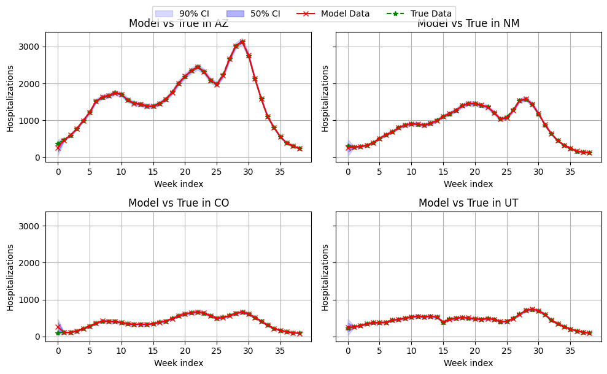
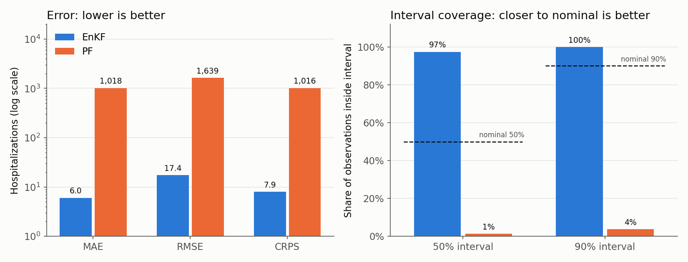
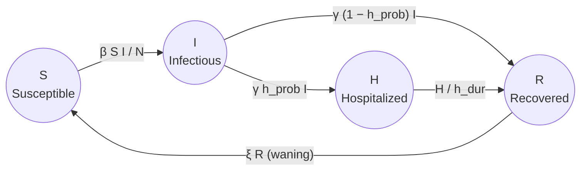
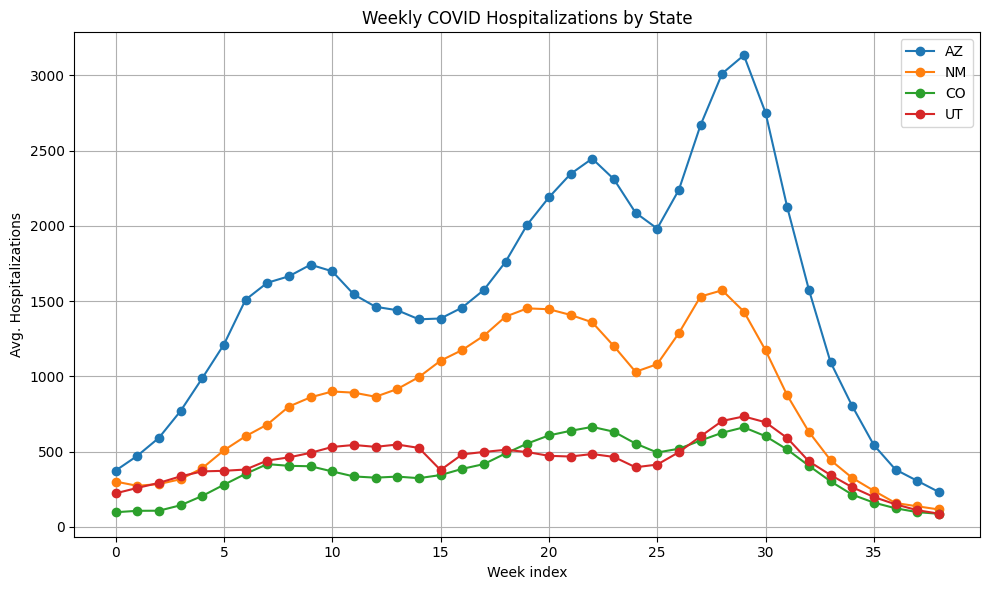
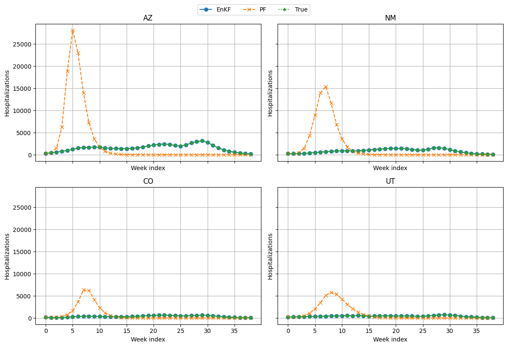
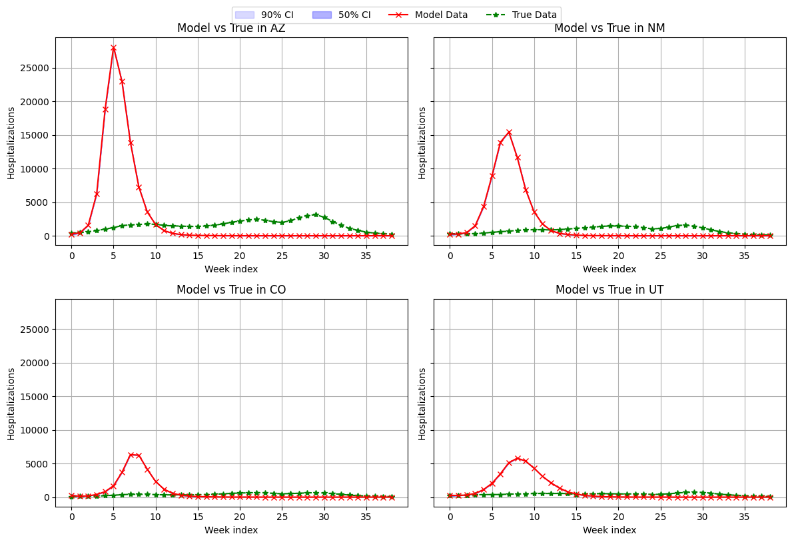

# Tracking COVID-19 Transmission with Data Assimilation: Particle Filter vs. Ensemble Kalman Filter

This project estimates the time-varying COVID-19 transmission rate **β(t)** from real hospitalization data. It couples a **spatial SIRH compartmental model** with two sequential data-assimilation methods, a **Particle Filter (PF)** and an **Ensemble Kalman Filter (EnKF)**, and compares how well each one tracks observed hospitalizations. It was built in Python for INF 514 (Modeling Infectious Disease, Northern Arizona University).

- **4 U.S. states** (Arizona, New Mexico, Colorado, Utah), linked by Census commuting flows
- **39 weeks** of CDC COVID-19 hospitalization data (July 1, 2021 – April 1, 2022) pulled with [epymorph](https://github.com/NAU-CCL/Epymorph)
- **2,000-member** ensembles for both filters, with a stochastic tau-leap simulator written from scratch
- Scored with **CRPS**, MAE, RMSE and 50% / 90% interval coverage


<sub>EnKF estimates of weekly hospitalizations (red) with 50% and 90% intervals (blue), compared with observed data (green) in each state.</sub>

## Headline result

| Metric | EnKF | Particle Filter |
|---|---|---|
| CRPS ↓ | **7.94** | 1016.30 |
| MAE ↓ (hospitalizations) | **6.04** | 1018.02 |
| RMSE ↓ | **17.41** | 1638.54 |
| 50% interval coverage (nominal 0.50) | 0.97 | 0.01 |
| 90% interval coverage (nominal 0.90) | 1.00 | 0.04 |
| Mean 90% interval width | 93.6 | 18.6 |

The EnKF stays close to the observed hospitalizations in all four states. The particle filter collapses onto a narrow, wrong set of trajectories: its intervals are tight but almost never contain the data.



## Model

A modified **SIRH** model adds a hospital compartment and waning immunity to the classic SIR model:



$$
\begin{aligned}
\frac{dS}{dt} &= -\beta \frac{SI}{N} + \xi R &
\frac{dI}{dt} &= \beta \frac{SI}{N} - \gamma I \\
\frac{dH}{dt} &= \gamma\, h_{\text{prob}}\, I - \frac{H}{h_{\text{dur}}} &
\frac{dR}{dt} &= \gamma (1 - h_{\text{prob}}) I + \frac{H}{h_{\text{dur}}} - \xi R
\end{aligned}
$$

| Parameter | Meaning | Value |
|---|---|---|
| β(t) | transmission rate (estimated) | prior U(0.2, 0.5) |
| γ | removal rate from I | 0.2 day⁻¹ |
| h_prob | share of removed infections that are hospitalized | 0.02 |
| h_dur | mean hospital stay | 5 days |
| ξ | waning immunity rate (R → S) | 1/365 day⁻¹ |

**Simulation.** The model is simulated stochastically with **Poisson tau-leaping**. Each day is split into an 8-hour daytime step and a 16-hour night-time step. During the day, S and I move between states according to a commuting matrix built from Census commuter flows, normalized by population. Each weekly observation is reached by propagating every ensemble member 7 days forward.

**Data assimilation.** Both filters estimate the joint state `[S, I, H, R, β]` in each state, using weekly hospitalizations H as the observation:

- **EnKF:** a perturbed-observation Kalman update corrects every ensemble member toward the observed H, and β is updated through its ensemble covariance with H.
- **Particle Filter:** β follows a random walk on the log scale, particles are weighted by a Poisson likelihood of the observed H, and the ensemble is resampled.

As a cross-check, the notebook also runs epymorph's built-in `ParticleFilter` on the same states with geometric Brownian motion dynamics for β.

## Results

### Observed data

Hospitalizations vary widely in size and timing across states. Arizona has the largest burden, with a Delta-wave peak near week 9 and an Omicron peak near week 29.



### EnKF vs. PF vs. observed

The EnKF (blue) sits on top of the observations (green) in every state. The PF (orange) overshoots badly early in the season, predicting up to about 28,000 hospitalizations in Arizona against about 1,500 observed, and then falls to near zero.



### Particle filter in detail

The PF's 50% and 90% intervals are so narrow that they are hidden behind the median line. This is a sign of **particle degeneracy**: after a few updates, almost all the weight sits on one or two particles, so the ensemble stops representing uncertainty and cannot recover once it drifts away from the data.



## Takeaways

- **The EnKF is much more robust here.** It tracked hospitalizations closely in all four states, with a CRPS about 128× lower than the PF.
- **The PF failed because of degeneracy, not because of the model.** Count data in the thousands make the Poisson likelihood extremely peaked, which concentrates weight on very few particles. Tempered likelihoods, a larger β perturbation, or a stochastic observation model are natural fixes.
- **Adding hospitalization matters.** Fitting to hospitalizations, a direct measure of healthcare burden, rather than to case counts gives estimates that are directly useful to public-health planners.

**Caveat:** these scores are for *filtered* estimates: each week's estimate has already seen that week's observation. They measure how well each method tracks the epidemic, not how well it forecasts. Out-of-sample, multi-week-ahead forecasting is the natural next step. Note also that the EnKF's 97% coverage of the 50% interval means its intervals are wider than necessary (over-dispersed).

The full write-up is in [`Modeling_Infectious_Disease_FinalReport.pdf`](Modeling_Infectious_Disease_FinalReport.pdf).

## Repository layout

```
Modeling_Infectious_Disease_FinalReport.pdf   final report
project/
  epi.ipynb                  full pipeline: data download, SIRH tau-leap model, EnKF, PF, metrics, plots
  make_metrics_figure.py     builds metrics_summary.png from the notebook's metrics table
  observation_data.png       observed weekly hospitalizations
  comparison.png             EnKF vs PF vs observed
  EnKF_quantiles.png         EnKF estimates with uncertainty intervals
  PF_quantiles.png           PF estimates with uncertainty intervals
  metrics_summary.png        error and coverage comparison
requirements.txt
```

## Reproducing

Requires Python ≥ 3.11 and a free [U.S. Census API key](https://api.census.gov/data/key_signup.html), which epymorph uses to download population and commuting data.

```bash
pip install -r requirements.txt
export CENSUS_API_KEY=your_key_here      # PowerShell: $env:CENSUS_API_KEY="your_key_here"
jupyter notebook project/epi.ipynb       # run all cells
```

With 2,000 ensemble members, each filter takes several minutes to run. Lower `ensemble_size` in the notebook for a quicker run.

## References

1. I. Cooper, A. Mondal, C. G. Antonopoulos. "A SIR model assumption for the spread of COVID-19 in different communities." *Chaos, Solitons & Fractals* 139 (2020).
2. S. Richardson et al. "Presenting characteristics, comorbidities, and outcomes among 5700 patients hospitalized with COVID-19 in the New York City area." *JAMA* 323(20) (2020).
3. A. Doucet, N. de Freitas, N. Gordon. "An introduction to sequential Monte Carlo methods." *Sequential Monte Carlo Methods in Practice* (2001).
4. G. Evensen. *Data Assimilation: The Ensemble Kalman Filter*. Springer (2009).

---
*Syed Md Shamsul Alam, PhD student, Northern Arizona University*
